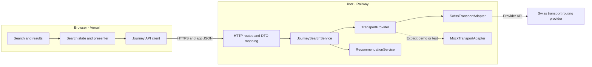
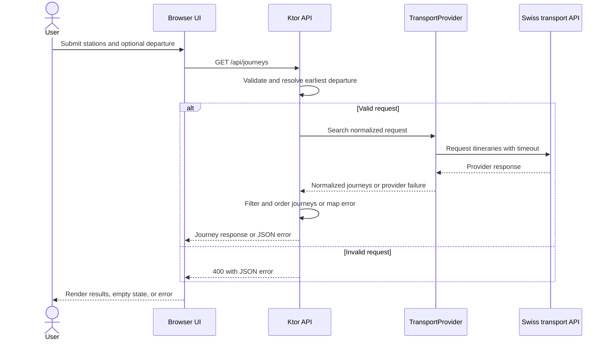
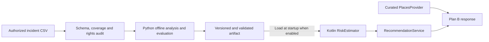

# System architecture

CFF Plan B is a Web-first Swiss public transport planner. The initial release asks a Swiss transport routing provider for valid journeys and recommends the eligible one with the earliest scheduled arrival. The browser runs on Vercel, the Kotlin/JVM Ktor API on Railway, and Python analytics runs offline. This is the target architecture. Check the handoff for implementation and deployment evidence. [Master plan](MASTER_PLAN.md) · [Session handoff](SESSION_HANDOFF.md)

## Runtime and ownership

| Owner | Boundary | Implementation responsibilities |
| --- | --- | --- |
| A · Frontend | `frontend/` | Build the search form, result cards and request states. Decode app-owned DTOs, format times in `Europe/Zurich` and show source labels. Prefer Compose Multiplatform Web/Wasm. Timebox the browser build to 45 minutes before switching to the master plan's minimal Web fallback in coordination with D. [Frontend interfaces](../frontend/INTERFACES.md) |
| B · Backend and transport | `backend/` | Implement Ktor routes, validation, upstream call timeouts, the transport adapter, ranking and normalized DTOs. Keep provider serialization in the adapter and test the provider boundary with permitted fixtures. [Backend interfaces](../backend/INTERFACES.md) |
| C · Analytics and data | `analytics/` | Audit available transport fields and prepare fixtures or contract checks in coordination with B. Verify CSV schema and data rights before analysis. Publish a versioned artifact only after the backend and analytics owners agree on its semantics. [Analytics interfaces](../analytics/INTERFACES.md) |
| D · Integration and deployment | `.github/`, `docs/`, deployment coordination | Review shared changes, coordinate Docker and build inputs with A and B, verify public deployments and record evidence for known-good commits. [Development workflow](DEVELOPMENT_WORKFLOW.md) · [Deployment](DEPLOYMENT.md) |

The browser only depends on the published HTTP API. The backend depends on the selected routing provider and the runtime environment. Offline analytics depends on authorized source data and has no role in serving journey requests for the MVP. The optional `shared/` directory documents contract conventions. A Kotlin DTO module requires agreement on JS/Wasm and JVM compatibility plus a concrete reuse benefit. [API contract](API_CONTRACT.md) · [Shared interfaces](../shared/INTERFACES.md)

## Journey search flow

1. The browser resolves any user-entered local departure to an offset timestamp in `Europe/Zurich`. Reject invalid or ambiguous local times until the user supplies an unambiguous choice. The client sends the query through its API wrapper and renders a loading state until the response arrives.
2. The Ktor route validates query parameters, obtains the current instant through an injected `Clock` when the departure is omitted, and delegates to `JourneySearchService`. Route code handles HTTP and DTO mapping. The service handles orchestration with app-owned types.
3. `TransportProvider.search(request): List<Journey>` returns normalized journeys or signals a typed provider failure. `SwissTransportAdapter` owns upstream parameters, response mapping, provider constraints and optional source fields. The selected routing provider validates the timetables and connections. The backend ranks those returned itineraries.
4. `RecommendationService.rank(journeys, preferences, deadline): List<RankedJourney>` keeps eligible routes and orders them deterministically. In v1 the preference is `FASTEST`, the deadline is unset and the first item is the earliest scheduled arrival among the eligible journeys returned. Compare instants across UTC offsets and date changes. Derive transfer buffers from consecutive scheduled legs when needed.
5. The API returns the effective request and ordered results. An empty valid response becomes a dedicated empty state. Validation or provider failures become a JSON error where the network allows it. Demo data uses `MOCK` in an explicit test or demo configuration, with visible provenance in the UI.

`GET /health` checks that the API process serves requests. Integration verifies provider access with a separate journey search. Use the runtime `PORT` and `0.0.0.0` for Ktor on Railway, a publicly readable build-time `API_BASE_URL` for the Vercel bundle, and `CORS_ALLOWED_ORIGINS` for the frontend origins the API accepts. Keep provider credentials, when required, in backend runtime configuration. Use bounds on upstream calls and log sanitized failures. [API contract](API_CONTRACT.md) · [Deployment](DEPLOYMENT.md) · [Testing](TESTING.md)

## Extension points after the stable MVP

- `RiskEstimator.estimate(journey, context): RiskEstimate?` returns unknown under the MVP's `NoPredictionEstimator`. Add an estimator that reads a versioned, evaluated artifact only when its coverage and journey linkage are documented. An unsupported version or unavailable data leaves risk unknown. Incident-only evidence can support descriptive historical insights. Calibrated journey probabilities require a suitable denominator, valid labels and temporal evaluation. [Analytics interfaces](../analytics/INTERFACES.md)
- Add deadline eligibility and preference scoring through `RecommendationService` once the API contract defines them. Preserve scheduled arrival as a comparable baseline. Record the factors behind each recommendation, especially when a later option is preferable under a user's constraints. [Roadmap](ROADMAP.md)
- A future `PlacesProvider.near(station, constraints): List<Place>` can serve curated, sourced backup options through a Plan B API with its own validation and provenance. Add workspace availability, fares, occupancy and additional live signals only after verifying data availability and quality.
- Keep initial search stateless. Persisted profiles, favorites or notification subscriptions would require a separate storage decision. Consider iOS and Android once the Web path is stable and the team has the relevant build and test environment. Review the HTTP boundaries before sharing UI or Kotlin DTO code. [Decisions](DECISIONS.md)

## Challenge extensions

The [challenge plan](CHALLENGES.md) adds a second KMP UI target for submission. Keep trip input, confirmed-field validation, extraction orchestration and recovery presentation in `commonMain` where supported. Use platform adapters for image selection and platform UI conventions. Ktor owns optional provider calls and disruption matching. Keep inference separate from deterministic journey ranking so manual search continues when the model path fails.
